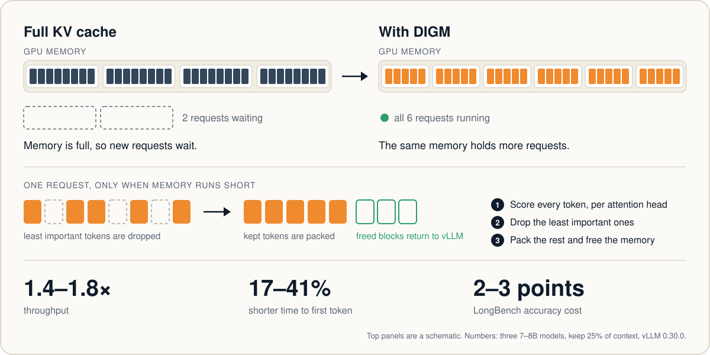

<h1 align="center">DIGM</h1>
<p align="center"><b>Dynamic Importance-Gated Memory</b><br>
KV-cache eviction for LLM serving, built on vLLM</p>

<p align="center">


</p>

<p align="center">
<a href="#about">About</a> ·
<a href="#results">Results</a> ·
<a href="#getting-started">Getting started</a> ·
<a href="#reproducing-the-paper">Reproducing the paper</a> ·
<a href="#try-it-on-your-hardware">Try it on your hardware</a> ·
<a href="#contributing">Contributing</a> ·
<a href="#citation">Citation</a>
</p>

<p align="center">

</p>

---

## About

An LLM server keeps a key-value (KV) cache entry for every token of every request. On a busy GPU this cache fills the memory and limits how many requests can run at once.

DIGM is an eviction layer for vLLM. It drops the least important cached tokens of a request, only when memory runs short, and it starts with the requests that tolerate eviction best.

On three 7–8B models it raises throughput by 1.4–1.8× and shortens time to first token by 17–41%, at a cost of 2–3 LongBench accuracy points. End-to-end latency gets longer; see [Results](#results).

## How it works

DIGM runs inside a stock vLLM engine, with no kernel changes.

| Part | What it does |
|---|---|
| **Per-head scoring** | Each attention head scores every cached token from its keys and keeps its own top tokens. No query is needed. |
| **Packing** | Kept tokens are copied to the front of the request's own blocks. The freed tail blocks go back to vLLM's block pool, so the memory is really returned. |
| **Position offset** | New tokens keep their original positions, so the model's position encoding stays correct after eviction. |
| **Preemption and chunked prefill** | An evicted request can still be preempted safely, and a long prompt can be evicted while it is being prefilled. |
| **Governor** | Eviction happens only when memory runs short. Requests shrink in steps of 12.5% of their context, never below 25%. |
| **Sensitivity** | A statistic of each request's scores predicts how well it tolerates eviction. Tolerant requests shrink first. |

When DIGM keeps every token, the output is identical to full-cache vLLM.

## Results

**In one line:** keeping only 25% of the KV cache, DIGM keeps 93–96% of LongBench accuracy and lets one GPU serve 1.4–1.8× more tokens per second. Needle-in-a-haystack retrieval (RULER) loses more, and we report that openly.

**Setup.** Three 7–8B instruction models (Llama-3.1-8B, Qwen2.5-7B, Mistral-7B), AWQ 4-bit, one RTX 4080 (16 GB), vLLM 0.30.0. "Full" means no eviction. "DIGM 25%" means 75% of the context's KV cache is evicted and its memory is returned to vLLM. Full details and confidence intervals are in the paper.

### 1. Accuracy when keeping 25% of the context

| Model | LongBench full | LongBench DIGM 25% | kept | RULER-4K full | RULER-4K DIGM 25% | kept |
|---|---|---|---|---|---|---|
| Llama-3.1-8B | 48.5 | 46.2 | 95% | 84.3 | 73.8 | 88% |
| Qwen2.5-7B | 48.9 | 46.9 | 96% | 84.7 | 65.4 | 77% |
| Mistral-7B | 47.0 | 43.6 | 93% | 82.1 | 68.1 | 83% |

"kept" = DIGM score ÷ full score.

How to read it:
- **LongBench** is closest to real use: summarising, answering questions about long documents, few-shot tasks. Here the drop is 2.0–3.4 points.
- **RULER** hides one or a few exact facts (a "needle") in a long text and asks for them. It is the hardest case for any eviction method: DIGM decides what to keep before it sees the question, so if the needle's tokens were evicted, the answer is wrong. That is why the drop here is 10–19 points.
- The **sensitivity-aware governor** (it keeps more memory in layers that break easily) beat the plain governor in 37 of 56 paired runs, and lost in 3; the gains were up to 7 accuracy points.

### 2. Serving: what the freed memory buys

| Measure | Effect of DIGM | Why |
|---|---|---|
| Throughput (generated tokens/s) | **1.4–1.8× higher** | each request uses ~4× less KV memory, so vLLM runs more requests at once |
| Time to first token | **17–41% shorter** | requests wait less in the queue to be admitted |
| Median end-to-end latency | 15–60% longer | the GPU is shared by more requests at once, so each one finishes a bit later |

This is the usual trade-off of serving more users per GPU: total work done goes up and replies start sooner, but a single request takes longer to finish. If you care only about the latency of one request at a time, eviction does not help.

### 3. Prompts longer than GPU memory

With eviction **during** prefill (`--long`), DIGM can run prompts that do not fit in the KV pool at all. Smaller check: Llama-3.2-3B, RTX 4070 laptop (8 GB), vLLM 0.33.0, 16K-token RULER prompts, a 9.6K-token KV pool, keep budget 2,048 tokens.

| Method | Prompts that ran (of 26) | Accuracy | Peak KV |
|---|---|---|---|
| Full KV | 0 (does not fit) | – | – |
| Evict after prefill | 0 (does not fit) | – | – |
| **DIGM, evict during prefill** | **26** | 52.4 | ~3.1K tokens |

### Correctness checks

Every run also checks that the eviction machinery itself is exact: with "evict nothing" (identity), DIGM must give the same output as plain vLLM, and it does on every question. Without DIGM's position (RoPE) fix, accuracy collapses (24 vs 52 on the first five questions, Llama-3.2-3B check), which shows the fix matters.

## Getting started

**Requirements**

- Any NVIDIA GPU that runs vLLM, with enough memory for the model you choose.
- vLLM 0.33.0 (latest tested) or 0.30.0. On 0.33.0 the correctness, throughput, preemption,
  long-prompt and CUDA-graph checks pass; the paper's numbers were measured on 0.30.0.
  DIGM reaches into vLLM internals, so untested versions may break.

| Tested so far | Models |
|---|---|
| 16 GB desktop GPU (RTX 4080) | Llama-3.1-8B, Qwen2.5-7B, Mistral-7B (AWQ 4-bit) |
| 8 GB laptop GPU (RTX 4070) | Llama-3.2-3B, Qwen2.5-3B (AWQ 4-bit) |

Other GPUs, larger models and unquantized models have not been tested yet. See [Try it on your hardware](#try-it-on-your-hardware).

```bash
git clone https://github.com/bhupalamjathin-svg/DIGM.git && cd DIGM
python3 -m venv ~/vllm_env && source ~/vllm_env/bin/activate
pip install -r requirements.txt
```

Models and datasets download from Hugging Face on first run (`simonjegou/ruler`, `Xnhyacinth/LongBench`).

**Quick check (3B model)**

```bash
cd paper_artifact
DIGM_SEL=head:cos python3 digm_vllm_v18.py
```

`DIGM_SEL=head:cos` selects the per-head scoring used in the paper. Without it the script falls back to an older single-layer selection (`one`), kept only for comparison.

The script loads `AMead10/Llama-3.2-3B-Instruct-AWQ` and runs each RULER test question four ways:

| Check | What it does | What to expect |
|---|---|---|
| A | Full KV cache, no eviction | baseline answer |
| B | "Eviction" that keeps every token | **must equal A exactly** |
| C | DIGM keeps 25% of the context | answer + number of freed blocks |
| D | Same as C without the position offset (first 5 questions) | shows why the offset is needed |

The script takes the model as its first argument, so you can run the same check on any model vLLM can load:

```bash
DIGM_SEL=head:cos python3 digm_vllm_v18.py <hugging-face-model-id>
```

For reference, with the default 3B model on an 8 GB laptop GPU the check takes under two minutes once the model has downloaded, and ends with:

```
identity eviction reproduces Full KV exactly : 26/26   (must be all)
per-head PERMUTED slots reproduce Full KV    : 26/26
evicted minus Full KV: -15.9 points, 95% CI [-22.1, -9.7]
```

If the first line is not N out of N, the vLLM version is wrong or something is broken. Stop there.
The accuracy drop is large here because this check uses RULER on a 3B model. Use `--longbench` for LongBench.

## Reproducing the paper

**On any GPU.** Leave the request rates out and the script measures what your GPU sustains with a full cache, then tests at 0.5×, 1× and 2× of that:

```bash
cd paper_artifact
export VLLM_ATTENTION_BACKEND=FLASH_ATTN VLLM_USE_FLASHINFER_SAMPLER=0
DIGM_SEL=head:cos DIGM_DEBUG=0 DIGM_NREQ=48 DIGM_GEN=256 \
DIGM_SENS_FLOOR=0.25 DIGM_SERVE_MODES=full,sens \
python3 digm_vllm_v18.py --serve <hugging-face-model-id> 4 0.85
```

`full` is the normal full cache and `sens` is DIGM's final policy. The last argument is the share of GPU memory vLLM may use.

**The paper's exact setting.** Mixed 4K/8K/16K prompts, bursty arrivals, at 1× and 2× of full-cache capacity, Llama-3.1-8B:

```bash
DIGM_SEL=head:cos DIGM_DEBUG=0 \
DIGM_MIX=4096:0.5,8192:0.3,16384:0.2 DIGM_BURST=2.0 DIGM_MAXLEN=24576 DIGM_NREQ=40 DIGM_GEN=256 \
DIGM_SEED=0 DIGM_SENS_FLOOR=0.25 DIGM_RATES=0.564,1.128 DIGM_SERVE_MODES=sens \
python3 digm_vllm_v18.py --serve hugging-quants/Meta-Llama-3.1-8B-Instruct-AWQ-INT4 4 0.85
```

Those rates (`DIGM_RATES`) are what 1× and 2× meant on the 16 GB GPU used for the paper. On other hardware, use the first command.

All runs: `bash run_lab_tue.sh`, then `bash run_lab_wed.sh`. They take many hours, skip any run that already finished, and expect the environment at `~/vllm_env`. The summaries they produced for the paper are in `paper_artifact/results/`.

**Modes**

| Flag | What it runs |
|---|---|
| (none) | the quick check above |
| `--throughput` | all requests submitted at once: full cache vs eviction |
| `--serve` | timed arrivals: time to first token, per-token time, latency, accuracy |
| `--stress` | small memory pool: preemption after eviction, with and without restore |
| `--long` | eviction during chunked prefill, for prompts longer than the memory pool |
| `--longbench` | LongBench accuracy at a fixed budget |

Settings are `DIGM_*` environment variables. They are commented near the top of the script and where each mode starts.

## Repository layout

```
docs/overview.svg      the diagram at the top of this page
paper_artifact/
  digm_vllm_v18.py     the script behind the paper's serving results (system + benchmarks in one file)
  run_lab_tue.sh       governor vs trigger vs sensitivity-aware governor; LongBench serving
  run_lab_wed.sh       sensitivity-aware governor with a 25% floor (final policy); more seeds
  results/             raw summaries from those two scripts
```

`digm_vllm_v18.py` is one file on purpose: it is the exact code that produced the numbers.

## Try it on your hardware

DIGM has only been tested on models up to 8B, on single 8 GB and 16 GB GPUs. Results on anything else are welcome, good or bad:

- larger models (13B, 32B, 70B) and unquantized models;
- larger GPUs (24 GB, 48 GB, 80 GB);
- other model families.

Run the quick check and the "any GPU" serving command, then open an issue using the **Share results** template. Reported results will be collected in a table here, with credit.

## Limitations

- Tested on vLLM 0.30.0 and 0.33.0 only.
- Single GPU, in-process engine, prefix caching off, async scheduling off.
- The paper's runs used eager mode (`DIGM_EAGER=1`, the default here).
- Other figures in the paper came from earlier versions of this script. They are not in this repo yet.

## Roadmap

- Split the script into a small library (core, benchmark, scoring).
- Port to the current vLLM release.
- Larger models and multi-GPU.

## Contributing

Issues and pull requests are welcome. See [CONTRIBUTING.md](CONTRIBUTING.md) for how to report a bug, what to check before a pull request, and how contributions are licensed.

## Citation

Will be added with the preprint.

## Patent and licence

Patent pending: Indian Patent Application No. 202641128952.

Licence: [PolyForm Noncommercial 1.0.0](LICENSE.md). You may use, change and share this code for research, study and other non-commercial purposes. For commercial use, please open an issue to contact the authors.

Required Notice: Copyright (c) 2026 Sai Jathin Bhupalam and Naveen N C

## Acknowledgements

DIGM is built on [vLLM](https://github.com/vllm-project/vllm). Accuracy is measured on RULER and LongBench.

The idea, experiments and results are the authors'. An AI assistant was used to write the code. The authors ran every experiment and checked the results.
